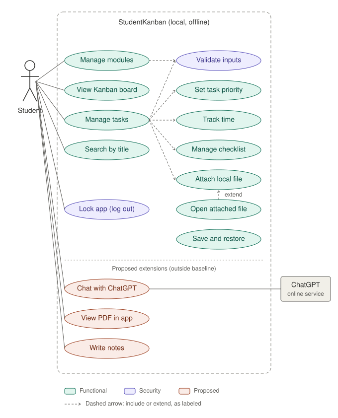

# StudentKanban — Use case diagram

## Actors

| Actor | Role |
|---|---|
| Student | Primary actor. Uses the application after unlocking it with the local app password. There is no account or registration. |
| ChatGPT online service | Secondary actor, **proposed extension only**. |

## Use cases

###  Core application (teal)
- **Manage modules**: create, view, edit, delete modules.
- **Manage tasks**: create, view, edit, delete tasks linked to an existing module. Includes *Set task priority*, *Track time* (estimated and actual), *Manage checklist* (one level), *Attach local file*, and *Validate inputs*.
- **View Kanban board**: three columns, À faire, En cours, Terminé.
- **Search by title**: search tasks by title.
- **Open attached file**: extends *Attach local file*; the OS default application opens the file.
- **Save and restore**: automatic save to local JSON, restore at startup.

All use cases in the "Unlocked app" zone require an active local session.

### Proposed extensions (coral, outside the current baseline)
- **Chat with ChatGPT**, **View PDF in app**, **Write notes**.

> These are **not** in the baseline scope. The README lists an integrated chatbot as out of scope, and ChatGPT requires network access, which conflicts with the offline-first requirement. Adopting them requires a recorded scope change approved by the client.

## Notes
- Open question: how the app password is first set (installation/first launch, or a "Set app password" use case with no account).
- Rules that are not use cases but belong in the requirements: passwords stored hashed, lockout enforced by time, file paths validated before opening.
- Plain-text source for editing: [`use-case-diagram.puml`](use-case-diagram.puml). The image is also available as [PNG](use-case-diagram.png).
